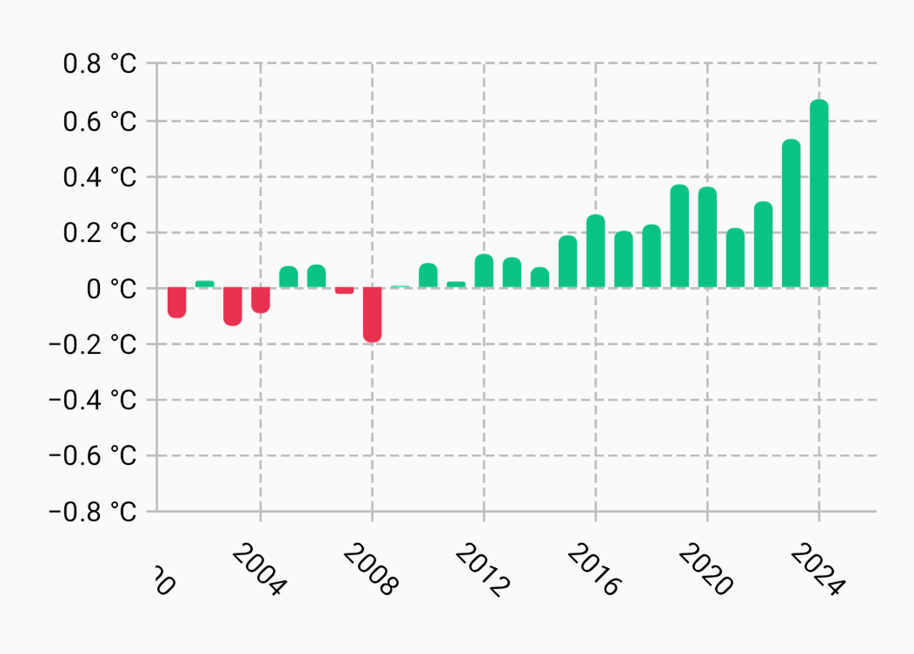
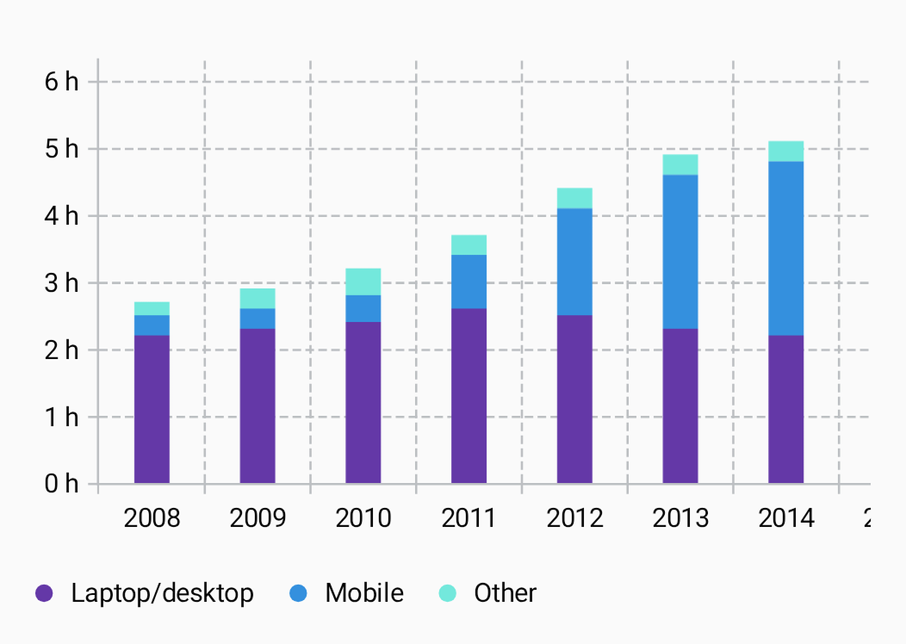
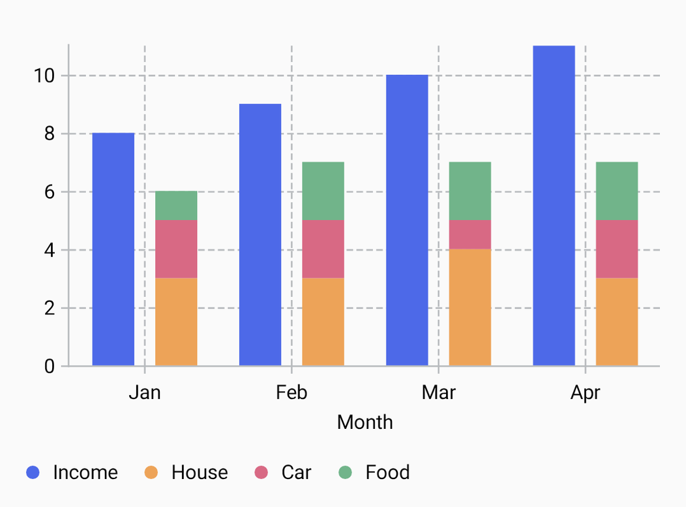

---
metaLinks:
  alternates:
    - >-
      https://app.gitbook.com/s/Wpa2ykTaKZoySxzNtySN/multiplatform/cartesian-charts/columncartesianlayer
---

# ColumnCartesianLayer

Use [`ColumnCartesianLayer`][column-cartesian-layer] to create column charts. Instantiate it via [`rememberColumnCartesianLayer`][remember-column-cartesian-layer].

Columns are drawn via [`LineComponent`][line-component] instances provided by [`ColumnProvider`][column-provider]. [`ColumnProvider.series`][column-provider-series] creates a `ColumnProvider` instance that uses one `LineComponent` instance per series. You can create your own implementation for custom behavior, including styling columns individually based on their _y_-values, as in the [“Temperature anomalies (June)”][temperature-anomalies-june] sample chart.

<figure><figcaption><p>The <a href="https://github.com/patrykandpatrick/vico/blob/stable/sample/shared/src/commonMain/kotlin/com/patrykandpatrick/vico/sample/charts/TemperatureAnomalies.kt">“Temperature anomalies (June)”</a> sample chart, which colors each column according to its <em>y</em>-value</p></figcaption></figure>

In `rememberColumnCartesianLayer`, you can also change column spacing. Data labels are supported. When multiple series are added, columns can be grouped horizontally or stacked. The [“Daily digital-media use (USA)”][daily-digital-media-use-usa] sample chart uses stacking.

<figure><figcaption><p>The <a href="https://github.com/patrykandpatrick/vico/blob/stable/sample/shared/src/commonMain/kotlin/com/patrykandpatrick/vico/sample/charts/DailyDigitalMediaUse.kt">“Daily digital-media use (USA)”</a> sample chart, which stacks its column series</p></figcaption></figure>

## Grouped stacking

To place stacks side by side, pass a `stackKey` selector to [`ColumnCartesianLayer.MergeMode.Grouped`][grouped]. The selector receives the key supplied to [`series`][series], or the series index if no key is supplied. It must be pure, and it may run on a background thread.

Series whose selector results are equal according to `equals` share a stack, and returning `null` keeps a series in its own column. Without a selector, columns are grouped horizontally without stacking.

Stacks are ordered by the first series belonging to each stack, and each stack is as wide as its widest column. Positive and negative values accumulate separately, upward and downward from zero. Data labels show each stack’s totals, and markers receive one target per stack at each _x_-value where that stack has data. The [“Grouped stacked column chart”][grouped-stacked-column-chart] sample chart stacks three expense series and keeps income in its own column.

<figure><figcaption><p>The <a href="https://github.com/patrykandpatrick/vico/blob/stable/sample/shared/src/commonMain/kotlin/com/patrykandpatrick/vico/sample/charts/GroupedStackedColumnChart.kt">“Grouped stacked column chart”</a> sample chart, which places an income column next to a stack of expenses</p></figcaption></figure>

```kt
val layer =
    rememberColumnCartesianLayer(
        mergeMode = {
            ColumnCartesianLayer.MergeMode.Grouped(
                stackKey = { seriesKey -> if (seriesKey == "Income") null else "Expenses" }
            )
        }
    )

cartesianChartModelProducer.runTransaction {
    columnModel {
        series(y = listOf(8, 9, 10, 11), key = "Income")
        series(y = listOf(3, 3, 4, 3), key = "House")
        series(y = listOf(2, 2, 1, 2), key = "Car")
        series(y = listOf(1, 2, 2, 2), key = "Food")
    }
}
```

## `Transaction.columnModel`

Column layers use [`ColumnCartesianLayerModel`][column-cartesian-layer-model] instances. When using [`CartesianChartModelProducer`][cartesian-chart-model-producer], add them via [`columnModel`][column-model]:

```kt
cartesianChartModelProducer.runTransaction {
    columnModel {
        series(1, 8, 3, 7)
        series(y = listOf(6, 1, 9, 3))
        series(x = listOf(1, 2, 3, 4), y = listOf(2, 5, 3, 4))
    }
    // ...
}
```

Each [`series`][series] invocation adds a series to the `ColumnCartesianLayerModel` instance. Above, three series are added. `series` has three overloads (each of which accepts all `Number` subtypes):

* a `vararg` overload that takes _y_-values and uses their indices as the _x_-values
* an overload that takes a collection of _y_-values and uses their indices as the _x_-values
* an overload that takes a collection of _x_-values and a collection of _y_-values of the same size

## Manual `ColumnCartesianLayerModel` creation

When creating a [`CartesianChartModel`][cartesian-chart-model] instance directly, you can add a column-layer model by using [`build`][build]. This function gives you access to the same DSL that `columnModel` does.

```kt
CartesianChartModel(
    ColumnCartesianLayerModel.build {
        series(1, 8, 3, 7)
        series(y = listOf(6, 1, 9, 3))
        series(x = listOf(1, 2, 3, 4), y = listOf(2, 5, 3, 4))
    },
    // ...
)
```

[column-cartesian-layer]: https://api.vico.patrykandpatrick.com/vico/compose/com.patrykandpatrick.vico.compose.cartesian.layer/-column-cartesian-layer/
[remember-column-cartesian-layer]: https://api.vico.patrykandpatrick.com/vico/compose/com.patrykandpatrick.vico.compose.cartesian.layer/remember-column-cartesian-layer.html
[line-component]: https://api.vico.patrykandpatrick.com/vico/compose/com.patrykandpatrick.vico.compose.common.component/-line-component/
[column-provider]: https://api.vico.patrykandpatrick.com/vico/compose/com.patrykandpatrick.vico.compose.cartesian.layer/-column-cartesian-layer/-column-provider/
[column-provider-series]: https://api.vico.patrykandpatrick.com/vico/compose/com.patrykandpatrick.vico.compose.cartesian.layer/-column-cartesian-layer/-column-provider/-companion/series.html
[temperature-anomalies-june]: https://github.com/patrykandpatrick/vico/blob/stable/sample/shared/src/commonMain/kotlin/com/patrykandpatrick/vico/sample/charts/TemperatureAnomalies.kt
[daily-digital-media-use-usa]: https://github.com/patrykandpatrick/vico/blob/stable/sample/shared/src/commonMain/kotlin/com/patrykandpatrick/vico/sample/charts/DailyDigitalMediaUse.kt
[column-cartesian-layer-model]: https://api.vico.patrykandpatrick.com/vico/compose/com.patrykandpatrick.vico.compose.cartesian.data/-column-cartesian-layer-model/
[cartesian-chart-model-producer]: https://api.vico.patrykandpatrick.com/vico/compose/com.patrykandpatrick.vico.compose.cartesian.data/-cartesian-chart-model-producer/
[column-model]: https://api.vico.patrykandpatrick.com/vico/compose/com.patrykandpatrick.vico.compose.cartesian.data/column-model.html
[series]: https://api.vico.patrykandpatrick.com/vico/compose/com.patrykandpatrick.vico.compose.cartesian.data/-column-cartesian-layer-model/-builder-scope/series.html
[cartesian-chart-model]: https://api.vico.patrykandpatrick.com/vico/compose/com.patrykandpatrick.vico.compose.cartesian.data/-cartesian-chart-model/
[build]: https://api.vico.patrykandpatrick.com/vico/compose/com.patrykandpatrick.vico.compose.cartesian.data/-column-cartesian-layer-model/-companion/build.html
[grouped]: https://api.vico.patrykandpatrick.com/vico/compose/com.patrykandpatrick.vico.compose.cartesian.layer/-column-cartesian-layer/-merge-mode/-grouped/
[grouped-stacked-column-chart]: https://github.com/patrykandpatrick/vico/blob/stable/sample/shared/src/commonMain/kotlin/com/patrykandpatrick/vico/sample/charts/GroupedStackedColumnChart.kt
